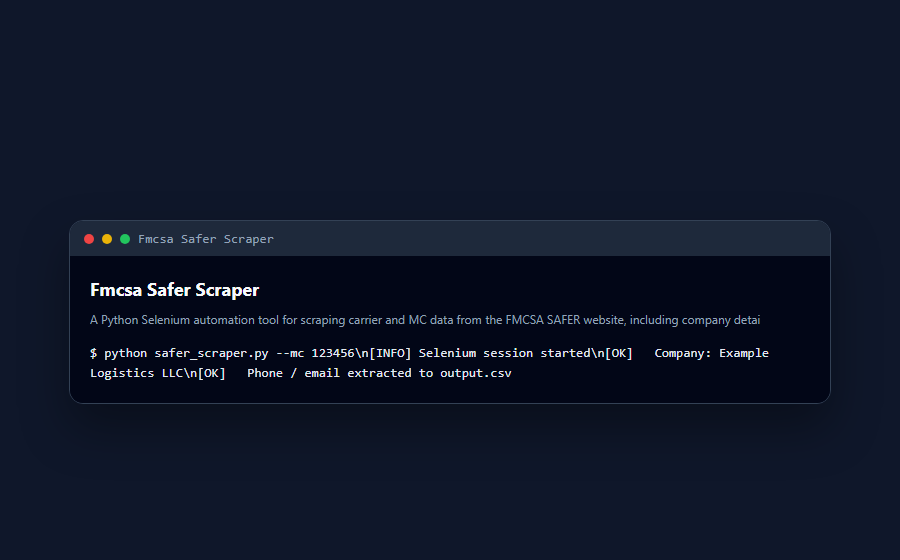

# FMCSA SAFER Scraper

  
  
  
  

  

  <strong>Python Selenium scraper for extracting carrier and MC data from FMCSA SAFER — company details, phones, addresses, and emails.</strong>

---

## Contribution Snake

  <picture>
    <source media="(prefers-color-scheme: dark)" srcset="https://raw.githubusercontent.com/mafzalkalwardev/google-voice-dispatch-agent/output/github-contribution-grid-snake-dark.svg">
    <source media="(prefers-color-scheme: light)" srcset="https://raw.githubusercontent.com/mafzalkalwardev/google-voice-dispatch-agent/output/github-contribution-grid-snake.svg">
    
  </picture>

---

## SEO Keywords

`FMCSA scraper` `SAFER` `MC number` `carrier data`

---

## Screenshots

## 🐍 Contribution graph

<picture>
  <source media="(prefers-color-scheme: dark)" srcset="https://raw.githubusercontent.com/mafzalkalwardev/fmcsa-safer-scraper/output/snake-dark.svg" />
  <source media="(prefers-color-scheme: light)" srcset="https://raw.githubusercontent.com/mafzalkalwardev/fmcsa-safer-scraper/output/snake.svg" />
  
</picture>

---

## 🚀 Quick start

Clone the repository and follow project-specific setup in docs.
