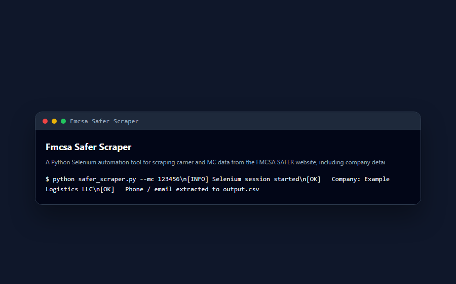

# FMCSA SAFER Scraper

[](https://github.com/mafzalkalwardev/fmcsa-safer-scraper/actions/workflows/ci.yml)
[](LICENSE)
[](.github/workflows/ci.yml)
[](apify-actor/Dockerfile)

Look up a U.S. motor carrier by **USDOT number**, **MC/FF/MX docket number**, or **legal or DBA name**. The Actor in [`apify-actor/`](apify-actor/) calls the [official FMCSA QCMobile API](https://mobile.fmcsa.dot.gov/qc/services/) with your own free WebKey and writes one dataset item per match: operating status, common/contract/broker authority, insurance filings, and safety rating.

You bring the WebKey. The repository does not ship one.

## Sample output

Excerpt of the dataset item `carrier_row` returns for the fixture in [`apify-actor/tests/test_mapping.py`](apify-actor/tests/test_mapping.py). The carrier name and the amounts are that fixture. They are not a live FMCSA record.

```json
{
  "found": true,
  "queryType": "dot",
  "query": "1000001",
  "dotNumber": "1000001",
  "legalName": "EXAMPLE HAULING LLC",
  "docketNumbers": ["MC-100001"],
  "allowedToOperate": "Y",
  "operatingStatus": "Allowed to operate",
  "statusCode": "A",
  "statusLabel": "Active",
  "carrierOperation": "Interstate",
  "commonAuthorityStatusLabel": "Active",
  "contractAuthorityStatusLabel": "Inactive",
  "brokerAuthorityStatusLabel": "None",
  "bipdInsuranceOnFile": "750",
  "bipdInsuranceOnFileUsd": 750000,
  "safetyRating": "S",
  "safetyRatingLabel": "Satisfactory",
  "phyCity": "DALLAS",
  "phyState": "TX",
  "totalPowerUnits": 3,
  "totalDrivers": 4,
  "source": "FMCSA QCMobile API",
  "sourceUrl": "https://mobile.fmcsa.dot.gov/qc/services/"
}
```

The same call also fills docket-level `authorityRecords`, cargo and bond filings, the physical street address, and `retrievalDate`. The full row from this fixture is the example in [`apify-actor/README.md`](apify-actor/README.md#output). Insurance amounts on the carrier record are thousands of U.S. dollars. `750` is stored again as `bipdInsuranceOnFileUsd: 750000`.

A USDOT miss is `found: false` with `message` set to `No carrier found for that USDOT number.` The WebKey is not written into the row.

## Why this exists

FMCSA publishes carrier registration, licensing, insurance, operating authority, and safety data through QCMobile. Each request sends your WebKey as the `webKey` query parameter. A WebKey is free: create one with a Login.gov account at [My WebKeys](https://mobile.fmcsa.dot.gov/QCDevsite/), then paste it into the Actor input. Apify stores that field encrypted (`isSecret`).

The page below is the public SAFER company snapshot saved at [`docs/screenshots/app.png`](docs/screenshots/app.png). The Actor reads the QCMobile API. Its HTTP client only calls `https://mobile.fmcsa.dot.gov`.



Field-by-field meanings, including how to read `Y` / `N` authority codes and safety ratings `S`, `C`, and `U`, are in the [Actor README](apify-actor/README.md#how-to-read-the-fields). A missing safety rating is labeled `Not rated`. Insurance figures are filings FMCSA has on record. Confirm coverage with the carrier's insurer before you rely on them.

## Quick start

The lookup command is `python -m fmcsa_actor` from `apify-actor/`. `44110` and `greyhound` are the sample queries named in FMCSA's API docs and in [`.actor/input_schema.json`](apify-actor/.actor/input_schema.json).

### Run the unit tests

The tests mock QCMobile. They do not call FMCSA and they do not need a WebKey. CI runs this on Python 3.12.

```bash
cd apify-actor
python -m unittest discover -s tests -v
```

### Run the Actor locally

```bash
cd apify-actor
python -m pip install -r requirements.txt
cat > INPUT.json << 'EOF'
{
  "webKey": "YOUR_FMCSA_WEBKEY",
  "dotNumber": "44110"
}
EOF
python -m fmcsa_actor
```

`INPUT.json` is gitignored. Dataset files are written under `storage/`. If a local SDK build reads the key-value store instead of the working directory, put the same JSON at `storage/key_value_stores/default/INPUT.json`.

Other inputs the parser accepts:

```json
{ "webKey": "YOUR_FMCSA_WEBKEY", "docketNumber": "MC-1515" }
```

```json
{ "webKey": "YOUR_FMCSA_WEBKEY", "carrierName": "greyhound", "maxResults": 10 }
```

`MC-1515`, `MC1515`, and `1515` query docket `1515`. `FF` and `MX` prefixes are kept on the result query. A leading `USDOT` label on `dotNumber` is ignored. `maxResults` applies to name search only, from 1 to 50, default 10. One run may set more than one of `dotNumber`, `docketNumber`, and `carrierName`. Each match is one dataset item.

An invalid WebKey fails the run. FMCSA often returns HTTP 404 with `content: "Webkey not found"` for a bad key. That is an authentication failure. The key is not copied into the dataset or the status message.

### Push to Apify

```bash
npm install -g apify-cli
apify login
cd apify-actor
apify push
```

`apify push` builds [`apify-actor/Dockerfile`](apify-actor/Dockerfile) and creates or updates the Actor on your Apify account. The image is `apify/actor-python:3.14`. The process command is `python -m fmcsa_actor`.

In [Apify Console](https://console.apify.com/), paste the WebKey into **FMCSA WebKey**, enter a USDOT number, an MC/docket number, or a carrier name, and run it. Open the **Output** tab, or `GET https://api.apify.com/v2/datasets/{defaultDatasetId}/items`.

To build from Git, create an Actor in Apify Console, connect this repository, and set the source directory to `apify-actor`.

### `python run.py`

From the repository root, `python run.py` checks an INDUS license and then prints `FMCSA SAFER Scraper — mount your scraper module after license verification.` That command does not look up a carrier. The license file is `indus-license*.json` in the root or in `data/`. `INDUS_SKIP_LICENSE=1` (also `true`, `yes`, or `on`) skips the check. The Actor package does not call this gate.

## The `apify-actor/` folder

| Path | Role |
| --- | --- |
| [`fmcsa_actor/main.py`](apify-actor/fmcsa_actor/main.py) | Apify entry. Reads input, runs the lookup, pushes rows to the default dataset. |
| [`fmcsa_actor/client.py`](apify-actor/fmcsa_actor/client.py) | GET client for `https://mobile.fmcsa.dot.gov/qc/services/carriers/`. |
| [`fmcsa_actor/input_parser.py`](apify-actor/fmcsa_actor/input_parser.py) | Requires `webKey` and at least one of DOT, docket, or name. |
| [`fmcsa_actor/mapping.py`](apify-actor/fmcsa_actor/mapping.py) | Maps the official JSON into the dataset row. Converts insurance thousands to dollars. |
| [`fmcsa_actor/errors.py`](apify-actor/fmcsa_actor/errors.py) | `FmcsaAuthError` for a rejected WebKey, `FmcsaApiError` otherwise. |
| [`.actor/actor.json`](apify-actor/.actor/actor.json) | Actor name `fmcsa-carrier-lookup`, title `FMCSA Carrier Lookup`, version `1.0`. |
| [`.actor/input_schema.json`](apify-actor/.actor/input_schema.json) | Input fields. `webKey` is required and secret. |
| [`.actor/dataset_schema.json`](apify-actor/.actor/dataset_schema.json) | Dataset fields and the Carriers table view. |
| [`requirements.txt`](apify-actor/requirements.txt) | `apify >= 4.0.0, < 5.0.0`. |
| [`Dockerfile`](apify-actor/Dockerfile) | `apify/actor-python:3.14`. `CMD` is `python -m fmcsa_actor`. |
| [`tests/`](apify-actor/tests/) | Unit tests. Mocked HTTP. No live FMCSA calls. |

Package version in code is `1.0.0` (`fmcsa_actor/__init__.py`).

For a USDOT number the client calls:

1. `GET /qc/services/carriers/{dotNumber}?webKey=...`
2. `GET /qc/services/carriers/{dotNumber}/authority?webKey=...`

A docket lookup uses `GET /qc/services/carriers/docket-number/{docketNumber}` and then the authority endpoint for each returned USDOT. A name lookup uses `GET /qc/services/carriers/name/{name}?webKey=...&start=0&size={maxResults}` and then authority for each USDOT. The official name search returns at most 50 carriers.

API documentation from FMCSA:

- [Getting started / WebKey](https://mobile.fmcsa.dot.gov/QCDevsite/docs/getStarted)
- [API access](https://mobile.fmcsa.dot.gov/QCDevsite/docs/apiAccess)
- [Endpoints](https://mobile.fmcsa.dot.gov/QCDevsite/docs/qcApi)

FMCSA is the source of the records. This Actor is not affiliated with the U.S. Department of Transportation or FMCSA. API availability, field presence, and rate limits are controlled by FMCSA.

## Docker images and CI

Two Dockerfiles live in the tree.

- [`apify-actor/Dockerfile`](apify-actor/Dockerfile) is the image `apify push` builds. It installs `requirements.txt` and runs the Actor.
- The [root `Dockerfile`](Dockerfile) is `alpine:3.20`. Its command prints `fmcsa-safer-scraper source package` and lists the files. [`.github/workflows/publish-docker.yml`](.github/workflows/publish-docker.yml) builds that root image and pushes `ghcr.io/mafzalkalwardev/fmcsa-safer-scraper` when a GitHub release is published.

[`.github/workflows/ci.yml`](.github/workflows/ci.yml) checks that `README.md` exists and runs `python -m unittest discover -s tests -v` in `apify-actor/` on Python 3.12.

## Contributing

See [CONTRIBUTING.md](CONTRIBUTING.md). Bug reports and feature requests have templates under [`.github/ISSUE_TEMPLATE/`](.github/ISSUE_TEMPLATE/). Security reports stay off the public tracker. See [SECURITY.md](SECURITY.md).

Maintainer: Muhammad Afzal Kalwar ([@mafzalkalwardev](https://github.com/mafzalkalwardev)). License: [MIT](LICENSE) (Copyright 2026 Muhammad Afzal / FT Solutions).

If this helped, a star helps others find it.
